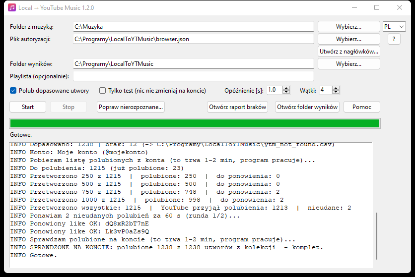
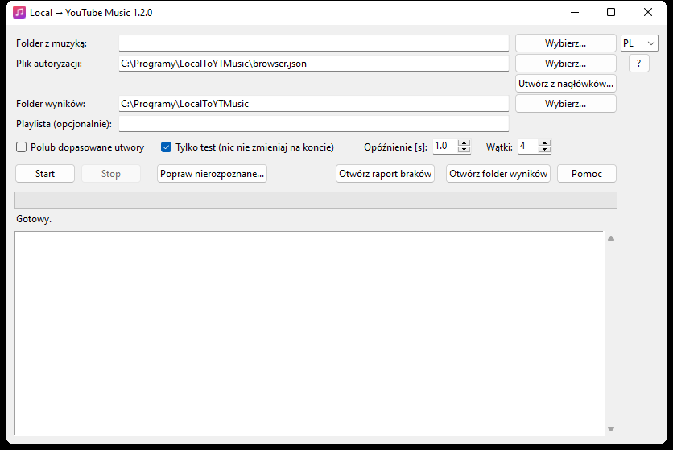
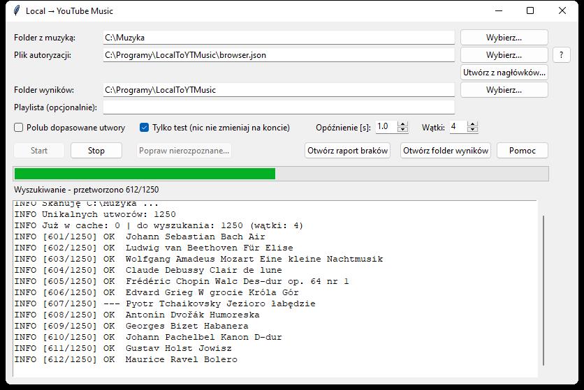
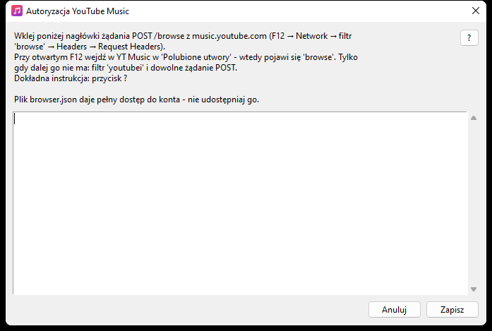
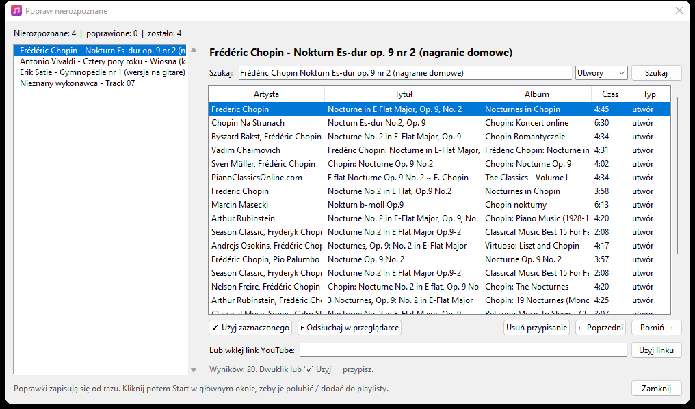

# Local → YouTube Music

Przenosi Twoją lokalną kolekcję muzyki (FLAC / MP3) do **YouTube Music**: wyszukuje każdy utwór, **polubia** go na Twoim koncie i/lub dodaje do **playlisty**. Dzięki temu rekomendacje i miksy YouTube Music opierają się na muzyce, której naprawdę słuchasz. Program dla Windows z prostym okienkiem, działa bez instalowania Pythona.

Moves your local music collection (FLAC / MP3) to **YouTube Music**: finds every track, **likes** it on your account and/or adds it to a **playlist**, so your YouTube Music recommendations and mixes are based on the music you actually listen to. Windows app with a simple GUI, no Python required.



<details open>
<summary><b>🇵🇱 Polski</b></summary>

## Co potrafi

- Skanuje folder z muzyką **razem z podfolderami**: pliki `.flac` i `.mp3`.
- Artystę i tytuł bierze z tagów, a gdy ich brak, z nazwy pliku `Artysta - Tytuł` (numer ścieżki z przodu jest pomijany).
- Wyszukuje utwory w YouTube Music **równolegle** (kilka wątków), bez logowania, więc nie obciąża konta.
- **Polubia** znalezione utwory (pomija już polubione) i/lub dodaje je do **playlisty**. Powyżej 5000 utworów sam tworzy kolejne części: „Nazwa 2”, „Nazwa 3”…
- Okno **„Popraw nierozpoznane”**: utwory, których nie znalazł, poprawiasz ręcznie, po kolei.
- Jest odporny na błędy YouTube:
  - ponawia nieudane zapytania;
  - odkłada nieudane polubienia na koniec;
  - przy problemach **sam zwalnia**;
  - gdy sesja wygaśnie, **prosi o nowe logowanie i pracuje dalej**.
- Na końcu **sprawdza na koncie**, ile utworów faktycznie jest polubionych.
- Zapamiętuje wyniki wyszukiwania, więc kolejne uruchomienie przerabia tylko nowe utwory.

## Pierwsze uruchomienie, krok po kroku

### 1. Pobierz i uruchom

Pobierz `LocalToYTMusic.exe` z zakładki **[Releases](../../releases)** i uruchom go. Instalacja nie jest potrzebna. Program zapisuje ustawienia i wyniki obok siebie, więc najlepiej trzymać go we własnym folderze, np. `C:\Programy\LocalToYTMusic\`.

> Windows SmartScreen może ostrzec o nieznanym programie (exe nie jest podpisany). Kliknij „Więcej informacji”, a potem „Uruchom mimo to”. Możesz też zbudować exe samodzielnie, patrz [Uruchamianie ze źródeł](#uruchamianie-ze-źródeł).



### 2. Najpierw test, bez logowania

1. W polu **Folder z muzyką** wybierz swój folder.
2. Zaznacz **Tylko test**.
3. Kliknij **Start**.

Program przeskanuje pliki i wyszuka je w YouTube Music, ale niczego nie zmieni na koncie. Zobaczysz, ile utworów znalazł, a lista nieznalezionych trafi do raportu (**Otwórz raport braków**).



### 3. Połącz program ze swoim kontem (plik `browser.json`)

Program loguje się na Twoje konto tak jak przeglądarka: nagłówkami skopiowanymi z zalogowanej karty. Robisz to raz.

1. Otwórz **okno incognito** (Ctrl+Shift+N) i wejdź na <https://music.youtube.com>. Zaloguj się, a jeśli masz kilka kanałów, przełącz się na ten, na który ma trafić muzyka.
2. Naciśnij **F12** i przejdź do zakładki **Network** (Sieć).
3. Przy otwartym F12 wejdź w YouTube Music w **Biblioteka → Polubione utwory**.
4. W filtrze wpisz `browse` i kliknij żądanie `browse?...` (metoda **POST**, status 200).
5. W **Headers** znajdź **Request Headers**, zaznacz całą sekcję i skopiuj ją.
   - Jeśli `browse` nie ma, wpisz w filtr `youtubei` i weź dowolne żądanie POST, np. `next` po kliknięciu piosenki.
6. W programie kliknij **Utwórz z nagłówków...**, wklej i kliknij **Zapisz**. Program sprawdzi logowanie i pokaże nazwę konta.
7. **Zamknij okno incognito.** Nie wylogowuj się, tylko zamknij.



> **Dlaczego incognito?** Otwarta karta YouTube co kilka minut wymienia ciasteczka logowania i wtedy skopiowany plik przestaje działać („SESJA WYGASŁA”). Zamknięte okno incognito niczego już nie wymienia, więc plik działa długo.

> ⚠️ `browser.json` daje **pełny dostęp do Twojego konta YouTube**. Nie wysyłaj go nikomu i nie wrzucaj do internetu (w tym repo jest w `.gitignore`).

### 4. Polub i/lub dodaj do playlisty

1. Odznacz **Tylko test**.
2. Zaznacz **Polub dopasowane utwory** i/lub wpisz nazwę **Playlisty**.
3. Kliknij **Start**.

Pasek na dole pokazuje postęp:

| Napis | Znaczenie |
|---|---|
| `przetworzono 750/4611` | ile utworów program już obsłużył |
| `polubione: 741` | ile polubień YouTube przyjął |
| `do ponowienia: 9` | nieudane, odłożone i ponawiane na końcu |
| `SPRAWDZONE NA KONCIE: polubione X z Y` | wynik końcowy, sprawdzony na Twoim koncie |


Gdy w trakcie wygaśnie sesja, program wstrzyma pracę i otworzy okno do wklejenia nowych nagłówków. Po zapisaniu pracuje dalej od tego samego miejsca. Nie przyjmie nagłówków z innego konta.

> **Im więcej utworów przerobisz na jednej sesji, tym częściej YouTube może ją wylogowywać.** Przy dużej kolekcji (tysiące polubień) okno z prośbą o nowe nagłówki może pojawić się kilka razy. To normalne: wklej świeże nagłówki z nowego okna incognito i program jedzie dalej. Pomaga też większe opóźnienie (3 s) albo podzielenie pracy na kilka podejść (**Stop**, a później **Start**).

### 5. Popraw nierozpoznane

Kliknij **Popraw nierozpoznane...**. Dla każdego nieznalezionego utworu możesz:
- poprawić wyszukiwany tekst i nacisnąć Enter;
- zmienić typ na „Filmy” albo „Wszystko”;
- odsłuchać wynik w przeglądarce;
- wkleić własny link z YouTube.

**Użyj zaznaczonego** przypisuje utwór i przechodzi dalej. Potem kliknij **Start**: program polubi tylko poprawione utwory, a resztę pominie.



## Ustawienia

| Pole | Opis |
|---|---|
| Folder z muzyką | folder z FLAC/MP3, podfoldery są przeszukiwane |
| Plik autoryzacji | `browser.json`, patrz krok 3 |
| Folder wyników | cache wyszukiwania `ytm_cache.json` i raport braków `ytm_not_found.csv` |
| Playlista | nazwa playlisty (prywatnej); puste oznacza brak playlisty |
| Polub dopasowane utwory | oznacza utwory jako „Lubię to” |
| Tylko test | tylko skan i wyszukiwanie, bez zmian na koncie i bez logowania |
| Opóźnienie [s] | przerwa między zapytaniami; przy dużej kolekcji polecane **3 s**; program sam podnosi je przy błędach (do 5 s) |
| Wątki | ile wyszukiwań naraz (1–8, domyślnie 4) |

**Ile to trwa?** Przy ok. 5000 utworów wyszukiwanie zajmuje kilkadziesiąt minut, a polubienia kilka godzin, bo YouTube pozwala lubić tylko pojedynczo. Program można przerwać (**Stop**) i wznowić później: zrobione rzeczy są pomijane.

Pełna instrukcja jest też w programie pod przyciskiem **Pomoc**.

## Warto: YouTube Music ReVanced

Gdy kolekcja jest już polubiona, najwygodniej słuchać jej na telefonie w **YouTube Music ReVanced**. To nieoficjalna, zmodyfikowana wersja aplikacji YouTube Music na Androida, z odtwarzaniem w tle i bez reklam.

- Instalacja przez **ReVanced Manager** z oficjalnej strony <https://revanced.app>. Nie pobieraj gotowych APK z innych stron.
- Zaloguj się tym samym kontem. Cała kolekcja będzie w **Biblioteka → Polubione**, a rekomendacje i miksy będą oparte na Twojej muzyce.

ReVanced to osobny projekt, niezwiązany z tym programem. Używasz go na własną odpowiedzialność.

## Uruchamianie ze źródeł

Wymagany jest Python 3.11+.

```bat
git clone https://github.com/pmcmal/local-to-ytmusic.git
cd local-to-ytmusic
py -3 -m venv .venv
.venv\Scripts\pip install -r requirements.txt
.venv\Scripts\python local_to_ytmusic.py
```

Budowanie exe (jeden plik, bez konsoli, wynik w `dist\LocalToYTMusic.exe`):

```bat
build.bat
```

Opcjonalny tryb z linii poleceń:

```bat
python local_to_ytmusic.py "D:\Muzyka" --dry-run
python local_to_ytmusic.py "D:\Muzyka" --like --playlist "Moja kolekcja" --delay 3
```

Dostępne opcje: `--auth`, `--out`, `--playlist`, `--like`, `--dry-run`, `--delay`, `--workers`, `--version`, `-h`.

## Uwagi

- Projekt nieoficjalny, niezwiązany z Google ani YouTube. Korzysta z biblioteki [ytmusicapi](https://github.com/sigma67/ytmusicapi), a tagi czyta przez [mutagen](https://github.com/quodlibet/mutagen).
- Dopasowanie jest automatyczne, więc zdarzają się pomyłki (inna wersja, remaster, live). Dlatego warto zacząć od **Tylko test** i przejrzeć raport.

## Licencja

[MIT](LICENSE)

</details>

<details>
<summary><b>🇬🇧 English</b></summary>

> The app's interface is in Polish. Button names are given below in Polish with English translations.

## Features

- Scans a music folder **including subfolders**: `.flac` and `.mp3` files.
- Reads artist/title from tags, falling back to the `Artist - Title` file name (a leading track number is ignored).
- Searches YouTube Music **in parallel**, without logging in, so it doesn't load your account.
- **Likes** matched tracks (skipping ones already liked) and/or adds them to a **playlist**. Above 5000 tracks it creates further parts automatically: "Name 2", "Name 3"…
- **"Popraw nierozpoznane"** (Fix unrecognized) window: fix unmatched tracks by hand, one by one.
- Robust against YouTube hiccups:
  - retries failed requests;
  - defers failed likes to the end;
  - **slows down automatically** when there are problems;
  - when the session expires, **asks for a new login and carries on**.
- At the end it **verifies on your account** how many tracks are actually liked.
- Caches search results, so the next run only processes new tracks.

## Getting started

### 1. Download and run

Download `LocalToYTMusic.exe` from **[Releases](../../releases)** and run it. No installation is needed. It stores settings and results next to itself, so keep it in its own folder.

> Windows SmartScreen may warn about an unknown app (the exe isn't signed). Click "More info", then "Run anyway". Or build it yourself, see [Running from source](#running-from-source).

### 2. Dry run first, no login needed

1. Pick your folder in **Folder z muzyką** (Music folder).
2. Tick **Tylko test** (Dry run).
3. Click **Start**.

Nothing is changed on your account. Unmatched tracks go to a report (**Otwórz raport braków**, Open missing report).

### 3. Connect your account (`browser.json`)

The app authenticates like your browser does: with request headers copied from a logged-in tab. You do this once.

1. Open an **incognito window** (Ctrl+Shift+N) and go to <https://music.youtube.com>. Log in, and if you have several channels, switch to the one you want.
2. Press **F12** and open the **Network** tab.
3. With F12 open, go to **Library → Liked songs** in YouTube Music.
4. Filter by `browse` and click the `browse?...` request (**POST**, status 200).
5. Under **Headers**, find **Request Headers**, select the whole section and copy it.
   - No `browse`? Filter by `youtubei` and take any POST request, e.g. `next` after clicking a song.
6. In the app click **Utwórz z nagłówków...** (Create from headers), paste and click **Zapisz** (Save). The app tests the login and shows the account name.
7. **Close the incognito window.** Don't log out, just close it.

> **Why incognito?** An open YouTube tab rotates the login cookies every few minutes, which makes the copied file stop working ("SESJA WYGASŁA", session expired). A closed incognito window no longer rotates anything, so the file keeps working.

> ⚠️ `browser.json` gives **full access to your YouTube account**. Never share or upload it (it is in `.gitignore`).

### 4. Like and/or add to a playlist

1. Untick **Tylko test**.
2. Tick **Polub dopasowane utwory** (Like matched tracks) and/or enter a **Playlista** (Playlist) name.
3. Click **Start**.

| Status text | Meaning |
|---|---|
| `przetworzono 750/4611` | processed so far |
| `polubione: 741` | likes accepted by YouTube |
| `do ponowienia: 9` | failed, retried at the end |
| `SPRAWDZONE NA KONCIE: polubione X z Y` | final result, verified on your account |

If the session expires mid-run, the app pauses and opens the header dialog. After you save, it continues where it left off. Headers from a different account are rejected.

> **The more tracks you process in one session, the more often YouTube may log it out.** With a large collection (thousands of likes) the new-headers dialog may pop up several times. That's normal: paste fresh headers from a new incognito window and the app carries on. A longer delay (3 s) or splitting the work into several runs (**Stop**, then **Start** later) also helps.

### 5. Fix unrecognized tracks

Click **Popraw nierozpoznane...** (Fix unrecognized). For each unmatched track you can:
- edit the search text and press Enter;
- switch the type to "Filmy" (Videos) or "Wszystko" (All);
- preview the result in the browser;
- paste your own YouTube link.

**Użyj zaznaczonego** (Use selected) assigns the track and moves on. Then click **Start**: only the fixed tracks get processed.

## Settings

| Field | Description |
|---|---|
| Folder z muzyką | music folder (FLAC/MP3), subfolders included |
| Plik autoryzacji | `browser.json`, see step 3 |
| Folder wyników | output folder: search cache `ytm_cache.json` and missing report `ytm_not_found.csv` |
| Playlista | playlist name (private); empty means no playlist |
| Polub dopasowane utwory | like matched tracks |
| Tylko test | scan and search only, no account changes, no login |
| Opóźnienie [s] | delay between requests; **3 s** recommended for large collections; raised automatically on errors (up to 5 s) |
| Wątki | parallel searches (1–8, default 4) |

**How long does it take?** For ~5000 tracks, searching takes tens of minutes and liking takes a few hours, because YouTube only allows liking one track at a time. You can **Stop** and resume later: completed work is skipped.

## Tip: YouTube Music ReVanced

Once your collection is liked, a convenient way to listen on your phone is **YouTube Music ReVanced**. It's an unofficial, patched version of the YouTube Music Android app, with background playback and no ads.

- Install it via **ReVanced Manager** from the official site <https://revanced.app>. Don't download prebuilt APKs from other sites.
- Log in with the same account. Your whole collection will be under **Library → Liked**, and recommendations and mixes will be based on your music.

ReVanced is a separate project, not affiliated with this app. Use it at your own risk.

## Running from source

Requires Python 3.11+.

```bat
git clone https://github.com/pmcmal/local-to-ytmusic.git
cd local-to-ytmusic
py -3 -m venv .venv
.venv\Scripts\pip install -r requirements.txt
.venv\Scripts\python local_to_ytmusic.py
```

Build the exe (single file, no console, output in `dist\LocalToYTMusic.exe`):

```bat
build.bat
```

Optional command-line mode:

```bat
python local_to_ytmusic.py "D:\Music" --dry-run
python local_to_ytmusic.py "D:\Music" --like --playlist "My collection" --delay 3
```

Options: `--auth`, `--out`, `--playlist`, `--like`, `--dry-run`, `--delay`, `--workers`, `--version`, `-h`.

## Notes

- Unofficial project, not affiliated with Google or YouTube. Built on [ytmusicapi](https://github.com/sigma67/ytmusicapi); tags are read with [mutagen](https://github.com/quodlibet/mutagen).
- Matching is automatic and can occasionally pick a different version (remaster, live). Start with a dry run and review the report.

## License

[MIT](LICENSE)

</details>
